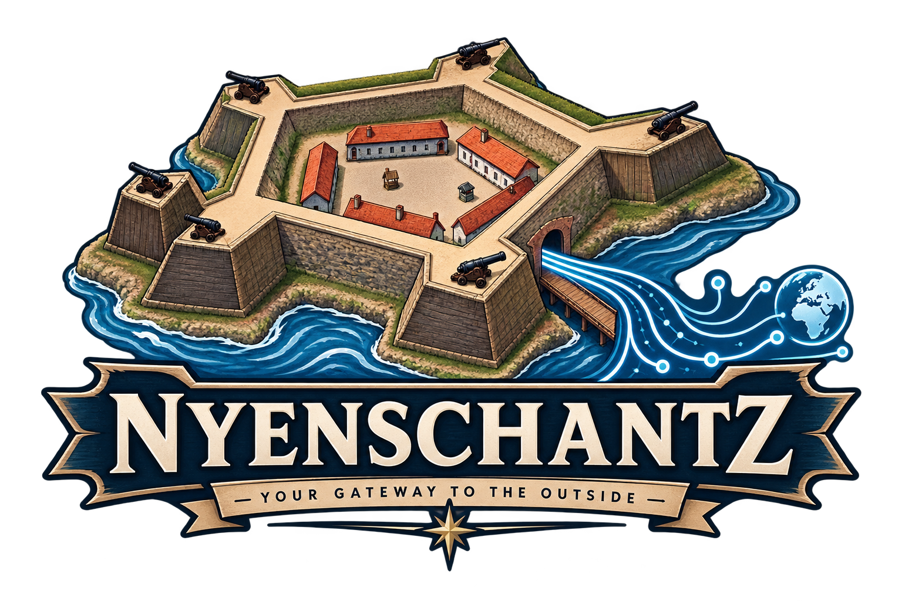

# Nyenschantz



Потоковый reverse proxy для API ИИ-платформ и других сервисов,
с доступом по персональному токену в пути и публичным лендингом на главной странице.
Запускается через Docker Compose: Caddy получает и продлевает HTTPS-сертификаты,
Node.js пересылает запросы настроенным upstream-серверам, Nginx отдаёт лендинг.
Формат API-адреса: `https://домен/<токен>/<маршрут>/...`.

```text
Интернет → Caddy :80/:443 ┬→ landing :8080 (только / и /assets/*)
                        └→ proxy :3000 → upstream
```

## Запуск на сервере

Нужны Docker Engine с Compose plugin, домен и доступные входящие TCP-порты 80/443.
DNS-запись A должна указывать на сервер. Если есть AAAA, IPv6 тоже должен работать.
Порты не должны быть заняты другим веб-сервером.

```sh
cp .env.example .env
```

Укажите свой домен в `.env`, проверьте `proxy.config.json`. Для доступа к API
подготовьте локальный файл пользователей, как описано ниже: все пользователи
в поставляемом `users.json` отключены. Без этого лендинг и healthcheck работают,
но API-запросы возвращают 404. Затем:

```sh
docker compose up -d --build
docker compose ps
docker compose logs -f
```

Caddy автоматически выпустит сертификат. HTTP перенаправляется на HTTPS.
Приложение не публикует свой порт на хосте. Сертификаты сохраняются в volume
`caddy_data`; **не используйте `docker compose down -v`**, если хотите их сохранить.

## Пользователи и токены доступа

Для API нужны два разных секрета:

- **токен Nyenschantz** в первом сегменте пути — даёт доступ к прокси;
- **API-ключ провайдера** в обычном заголовке, например `Authorization: Bearer ...`
  для OpenRouter или `x-goog-api-key` для Gemini.

`users.json` хранится в Git и содержит только отключённые демонстрационные записи:

```json
{
  "users": {
    "example-user": {
      "token": "ExampleUser1",
      "disabled": true
    },
    "example-bot": {
      "token": "ExampleBot01",
      "disabled": true
    }
  }
}
```

**Эти токены публичны. Не включайте демонстрационные записи без замены токенов.**
Настоящие токены храните в локальном файле, исключённом из Git:

```sh
cp users.json users.local.json
```

В `.env` укажите путь на хосте (Compose подключит выбранный файл read-only как
`/app/users.json`; по умолчанию используется `./users.json`):

```dotenv
USERS_FILE=./users.local.json
```

### Генерация токена

Токен — ровно **12 символов** из `A–Z`, `a–z`, `0–9`, `_`, `-`.
Генерируйте его из 9 криптографически случайных байт: это 72 бита энтропии.
Не придумывайте токены вручную. Достаточно любого одного способа:

```sh
# OpenSSL
openssl rand -base64 9 | tr '+/' '-_'

# Node.js >=24
node -e "console.log(require('node:crypto').randomBytes(9).toString('base64url'))"

# Без Node.js на хосте, через Docker
docker run --rm node:24-alpine node -e \
  "console.log(require('node:crypto').randomBytes(9).toString('base64url'))"
```

Каждая команда выдаёт 12-символьный токен, безопасный для URL, без padding.
Выдавайте отдельный токен каждому пользователю. Запишите его в поле `token`
соответствующей записи в `users.local.json` и поставьте `disabled: false`.
Имя записи — произвольная непустая метка; оно не передаётся в URL.
Поле `disabled` обязательно и принимает только `true` или `false`.

**Токены хранятся открытым текстом**, без хеширования. Чтение файла или его
резервной копии даёт доступ к прокси. Ограничьте права файла, сохранив возможность
чтения пользователем контейнера `node` (UID/GID 1000 в текущем образе).
Например, на Linux для локального файла:

```sh
sudo chgrp 1000 users.local.json
chmod 640 users.local.json
```

После изменения `USERS_FILE` выполните `docker compose up -d proxy`.
После изменения содержимого файла пользователей выполните
`docker compose restart proxy`. Для отзыва доступа поставьте `disabled: true`
или удалите пользователя и перезапустите `proxy`; для замены токена обновите
поле `token` и также перезапустите сервис. Уже начатые запросы могут продолжаться
до завершения или истечения 10-секундного периода остановки.

Отсутствующий, нечитаемый или некорректный файл, неправильный формат токена,
неверный тип `disabled` и повторяющиеся токены (включая отключённые записи)
блокируют запуск. Пустой список пользователей и только отключённые записи
допустимы, но не открывают API никому.

### Подключение

```sh
# Подставьте свои значения, не публикуйте их.
export NYENSCHANTZ_TOKEN='YOUR_PROXY_TOKEN'
export GEMINI_API_KEY='YOUR_GEMINI_API_KEY'
export GEMINI_MODEL='YOUR_GEMINI_MODEL'

curl "https://proxy.example.com/$NYENSCHANTZ_TOKEN/gemini/v1beta/models/$GEMINI_MODEL:generateContent" \
  -H "x-goog-api-key: $GEMINI_API_KEY" \
  -H 'Content-Type: application/json' \
  -d '{"contents":[{"parts":[{"text":"Привет!"}]}]}'
```

В OpenAI SDK для Python используйте
`base_url=f"https://proxy.example.com/{proxy_token}/openrouter"`, где
`proxy_token` — токен Nyenschantz, а `api_key` — ключ OpenRouter.
Дополнительные примеры доступны на лендинге.

**Несовместимое изменение:** старые пути `/gemini/...`, `/openrouter/...`,
`/telegram/...` и `/cloudflare/...` без токена больше не работают.
Нет токена, неверный/отключённый токен и неизвестный маршрут возвращают
одинаковый JSON 404. Авторизация распространяется на все API-маршруты.
Секретный префикс удаляется перед отправкой upstream; заголовок `Authorization`
остаётся доступен провайдеру. Логин и пароль в URL не используются.

## Маршруты

Путь `/` открывает страницу Nyenschantz с описанием и примерами Gemini,
OpenRouter, OpenAI SDK для Python и потоковых ответов. Публичный путь `/assets/*`
зарезервирован для статики лендинга.
Все остальные пути, в том числе неизвестные, обрабатывает Node.js-прокси.

В `proxy.config.json` сегменту сразу после токена соответствует upstream:

```json
{
  "routes": {
    "cloudflare": {
      "target": "https://api.cloudflareclient.com/v0i1909051800"
    },
    "myservice": {
      "target": "https://api.example.com/v1"
    }
  }
}
```

Запрос `https://proxy.example.com/<токен>/myservice/users?limit=10` уйдёт на
`https://api.example.com/v1/users?limit=10`. Query-параметры target сохраняются
и дополняются параметрами запроса. Конфигурация проверяется при запуске;
допускаются только HTTP/HTTPS без логина, пароля и fragment.

Файл подключён read-only. После изменения маршрутов:

```sh
docker compose restart proxy
```

После изменения `.env` используйте `docker compose up -d`.

### Список доступных маршрутов

`GET /<токен>/routes` возвращает JSON с объектом `routes`: для каждого маршрута —
`target` и `description`, если описание задано строкой. Все активные пользователи
видят один список. Токены, файл пользователей и прочие поля конфигурации не выдаются.

```sh
curl "https://proxy.example.com/$NYENSCHANTZ_TOKEN/routes"
# Сохранить как файл:
curl --fail "https://proxy.example.com/$NYENSCHANTZ_TOKEN/routes" -o proxy.config.json
```

Ответ отражает конфигурацию работающего процесса: изменения файла применяются
после перезапуска `proxy`. Это не проверка доступности upstream.
Ответ не кешируется (`Cache-Control: no-store`). Поддерживаются `GET` и `HEAD`;
остальные методы с действующим токеном возвращают 405 (`method_not_allowed`,
`Allow: GET, HEAD`). Без действующего токена — обычный JSON 404.
Имя маршрута `routes` зарезервировано и не может использоваться в конфигурации.

## Передача данных

- Тела запросов и ответов передаются потоком, без полной буферизации; SSE поддерживается.
- Статусы, сжатые тела, `Authorization`, `Cookie` и несколько `Set-Cookie` сохраняются.
- `Host` заменяется адресом upstream; hop-by-hop, входящие `Forwarded`/`X-Forwarded-*`
  и `Referer` (он может содержать URL с токеном) удаляются.
- Редиректы возвращаются клиенту как есть, включая исходный `Location`.
- WebSocket, HTTP trailers и CONNECT не поддерживаются.
- `UPSTREAM_TIMEOUT_MS` (по умолчанию 60000) ограничивает ожидание заголовков
  upstream и простой его сокета. Это не ограничение общей длительности SSE:
  поток может работать долго, если регулярно поступают данные.

Логи приложения содержат метод, ключ маршрута, статус и длительность. Полные пути
(в них могут быть токены), query-параметры, тела и заголовки не логируются.
Access log Caddy выключен; его служебные/диагностические сообщения могут содержать
детали запросов, поэтому доступ к логам должен быть ограничен.

## JSON-ошибки

Для неизвестного API-маршрута и отсутствующего, неверного или отключённого
токена возвращается одинаковый HTTP 404:

```json
{"error":{"code":"route_not_found","message":"Route not found"}}
```

Собственные ошибки API-прокси имеют `Content-Type: application/json` и
`Cache-Control: no-store` (ошибки статических файлов лендинга обрабатывает Nginx):

| Статус | Код | Причина |
| --- | --- | --- |
| 400 | `bad_request` | Некорректный HTTP-запрос или путь |
| 404 | `route_not_found` | Неизвестный маршрут или нет доступа |
| 500 | `internal_error` | Внутренняя ошибка приложения |
| 502 | `upstream_unavailable` | Ошибка соединения с upstream |
| 504 | `upstream_timeout` | Истекло время ожидания upstream |
| 5xx | `gateway_error` | Ошибка Caddy, например приложение недоступно |

Ошибки конфигурации и очевидные циклы (собственный домен, localhost, имена
контейнеров) предотвращают запуск. Это не защита от всех DNS-алиасов и циклов:
используйте только доверенные target.

Ответы upstream, в том числе HTML-ошибки, передаются без преобразования в JSON.
Если передача ответа уже началась, при сбое соединение закрывается:
заменить отправленные заголовки и тело JSON-ошибкой невозможно.
HTTP HEAD по стандарту возвращает только заголовки, без тела.

## Ручная проверка на ВМ

Подставьте свой домен:

```sh
curl -I http://proxy.example.com/
curl -i https://proxy.example.com/
curl -I https://proxy.example.com/assets/style.css
curl -i https://proxy.example.com/unknown/path
curl -i https://proxy.example.com/gemini/
curl -i "https://proxy.example.com/$NYENSCHANTZ_TOKEN/unknown/path"
curl -i "https://proxy.example.com/$NYENSCHANTZ_TOKEN/cloudflare/"
```

Проверьте POST с телом и SSE (`curl -N`) на подходящем настроенном upstream.
Главная страница должна возвращать HTML с HTTP 200, CSS — HTTP 200,
неизвестный API-маршрут и запрос без токена — одинаковый JSON с HTTP 404.
`NYENSCHANTZ_TOKEN` должен содержать действующий токен из локального файла.
Проверьте переключение примеров и копирование: в код подставляется текущий домен страницы.

Для проверки 502 временно добавьте target `http://127.0.0.2:65534` и перезапустите
приложение. Для 504 используйте контролируемый upstream, который задерживает
заголовки дольше `UPSTREAM_TIMEOUT_MS`. Удалите временные маршруты после проверки.

Проверка JSON-ошибки Caddy при остановленном приложении:

```sh
docker compose stop proxy
curl -i "https://proxy.example.com/$NYENSCHANTZ_TOKEN/cloudflare/"
docker compose start proxy
```

## Обновление и остановка

```sh
git pull
docker compose build --pull
docker compose pull caddy
docker compose pull landing
docker compose up -d
```

Остановка: `docker compose down` (сертификаты сохраняются).
При завершении приложение даёт активным запросам до 10 секунд.

## Лендинг

Страница находится в `landing/public/`, конфигурация Nginx — в
`landing/nginx.conf`. Лендинг работает отдельным контейнером без root,
с read-only файловой системой, без опубликованного на хост порта.
Изображение `/assets/logo.png` берётся из существующего `logo.png` в корне проекта.
Ни шрифты, ни скрипты, ни изображения со сторонних сайтов не загружаются.

HTML/CSS/JS подключены read-only с хоста: после правок пересборка не нужна.
HTML не кешируется, статика кешируется до часа. При изменении конфигурации Nginx
выполните `docker compose restart landing`. После изменения `Caddyfile` —
`docker compose restart caddy`.

Примеры автоматически используют текущий origin страницы и переменные окружения
для токена прокси, API-ключей и идентификаторов моделей. В карточках платформ
используется заполнитель `YOUR_PROXY_TOKEN`. Модели выбирайте из актуального
каталога провайдера. Страница не принимает и не сохраняет настоящие токены
и ключи, не выполняет API-запросы. Генерация токенов описана только в README.

Для локального просмотра без остальных сервисов:

```sh
DOMAIN=localhost docker compose run --rm --no-deps \
  -p 127.0.0.1:8080:8080 landing
```

Откройте `http://localhost:8080`. API-прокси при этом не запускается.

## Тесты

```sh
npm test
```

Без Node.js на хосте можно использовать изолированный контейнер:

```sh
docker run --rm --network none -v "$PWD:/app:ro" -w /app node:24-alpine npm test
```

Тесты используют временные файлы и локальный upstream, не обращаются к внешним
API и не читают настоящий файл пользователей. Интеграционные тесты используют
порты 3000/3001 внутри тестового окружения: они должны быть свободны.

## Безопасность

Любой обладатель активного токена может обращаться ко всем настроенным upstream
через ваш сервер и расходовать трафик и квоты. Разделения прав по маршрутам,
ограничений частоты запросов и квот на пользователя пока нет. Не добавляйте
приватные сервисы и target с секретами в query. Секреты клиентов должны
передаваться самими клиентами.
Используйте HTTPS. Токен в URL — секрет: он может попасть в историю браузера,
команд, логи SDK, Caddy или внешнего мониторинга. Access log Caddy выключен,
но диагностические сообщения могут содержать URL. Не публикуйте реальные
токены в Git или скриншотах; опубликованный токен замените, даже если потом
удалили его из репозитория. 12 символов — компромисс для небольшого доверенного
круга пользователей, а не замена защите от перебора и утечек.
Список маршрутов ограничен конфигурацией: произвольный target из запроса не принимается.
Приложение работает не от root, с read-only файловой системой; Docker-логи ротируются.
